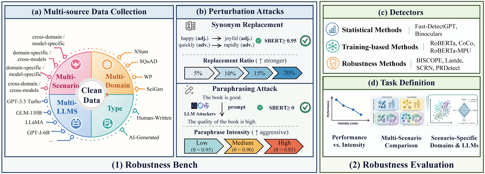

# RobustStress: Stress-Testing AI-Generated Text Detectors under Gradual Perturbations

<div  align="center">
<a href="https://huggingface.co/datasets/EthanYan12581/RobustStress" alt="Hugging Face Models">
    </a>
</div>

<h5 align="center"> 
If you like our project, please give us a star ⭐ on GitHub and cite our paper.
</h5>

<div  align="center">
This repository is the official implementation of RobustStress, the first benchmark framework for AI-generated text detection with explicit control over perturbation intensity, enabling a systematic characterization of how detector performance evolves as perturbation intensity increases.
</div>

---

## 📣 News

* ⏳⏳⏳ Our code and data are released.
* ✨ Our paper is accepted by **NeurIPS ED 2026**.

## 🧐 Overview



Detecting text generated by large language models (LLMs) is a critical line of defense for ensuring information security. While recent studies have increasingly focused on evaluating the robustness of detectors, existing benchmarks suffer from two limitations: (1) a lack of ability to grade and control perturbation intensity, making it difficult to systematically assess how performance changes with varying attack intensity; and (2) a failure to observe the combined effects of perturbation intensity on detector robustness in complex scenarios, such as cross-domain and cross-model settings.
To address these challenges, we propose RobustStress, a novel stress-testing framework for intensity-controlled perturbations. We achieve quantitative classification of perturbation intensity by varying the proportion of synonym replacement and employing graded paraphrasing attacks via LLMs.

### 📥 How to Get the Data

The complete RobustStress benchmark is hosted on Hugging Face: 

**Dataset:** [RobustStress](https://huggingface.co/datasets/EthanYan12581/RobustStress)

The repository contains the clean splits and the filtered perturbation
variants used in our experiments. It can be downloaded with:

```bash
pip install -U huggingface_hub

hf download EthanYan12581/RobustStress \
  --repo-type dataset \
  --local-dir ./data/RobustStressBench
```


## 🏆 Data Statistics
| Scenario | Group | Clean Data: Train | Clean Data: Valid | Clean Data: Test | SR-5% | SR-10% |      SR-15% | SR-20% |
| :--- | :--- | ---: | ---: | ---: | ---: | ---: |------------:| ---: |
| DSMS | XSum | 1,528 | 191 | 191 | 191 | 191 |         191 | 190 |
| DSMS | SQuAD | 1,230 | 81 | 93 | 93 | 93 |          92 | 90 |
| DSMS | WP | 1,373 | 176 | 175 | 174 | 171 |         162 | 164 |
| DSMS | SciGen | 1,195 | 136 | 148 | 146 | 147 |         146 | 146 |
| DSCM | XSum | 30,759 | 6,529 | 6,537 | 6,528 | 6,509 |       6,479 | 6,446 |
| DSCM | SQuAD | 35,760 | 4,999 | 5,004 | 4,990 | 4,974 |       4,926 | 4,901 |
| DSCM | WP | 31,159 | 6,214 | 6,236 | 6,177 | 6,097 |       6,008 | 5,941 |
| DSCM | SciGen | 23,127 | 4,843 | 4,789 | 4,758 | 4,720 |       4,654 | 4,580 |
| CDMS | GPT-3.5 | 106,678 | 13,264 | 13,284 | 13,213 | 13,098 |      12,910 | 12,738 |
| CDMS | GLM-130B | 14,688 | 1,838 | 1,838 | 1,825 | 1,819 |       1,783 | 1,768 |
| CDMS | LLaMA-13B | 59,690 | 7,398 | 7,420 | 7,380 | 7,326 |       7,262 | 7,166 |
| CDMS | GPT-J-6B | 23,170 | 2,800 | 2,884 | 2,868 | 2,848 |       2,809 | 2,786 |
| CDCM | All | 319,071 | 56,792 | 56,819 | 56,564 | 55,972 |      55,313 | 54,543 |
| **Total** | | **649,428** | **105,261** | **105,418** | **104,907** | **103,965** | **102,735** | **101,459** |

❗Caption: SR-$r$ denotes synonym replacement with replacement ratio $r$. 
DSMS, CDMS, DSCM, and CDCM denote domain-specific-model-specific, 
cross-domains-model-specific, domain-specific-cross-models, and cross-domains-cross-models, respectively.

| Scenario | Group | Qwen2.5-7B Low | Qwen2.5-7B Medium | Qwen2.5-7B High | Llama3-8B Low | Llama3-8B Medium | Llama3-8B High | Qwen3-14B Low | Qwen3-14B Medium | Qwen3-14B High |
| :--- | :--- | ---: | ---: | ---: | ---: | ---: | ---: | ---: | ---: | ---: |
| DSMS | XSum | 98 | 126 | 159 | 84 | 74 | 94 | 188 | 180 | 187 |
| DSMS | SQuAD | 52 | 71 | 82 | 36 | 33 | 50 | 92 | 84 | 88 |
| DSMS | WP | 43 | 59 | 97 | 37 | 15 | 10 | 172 | 144 | 155 |
| DSMS | SciGen | 114 | 132 | 137 | 91 | 108 | 119 | 143 | 143 | 146 |
| DSCM | XSum | 3,339 | 4,772 | 5,991 | 2,576 | 2,728 | 3,361 | 6,312 | 6,065 | 6,253 |
| DSCM | SQuAD | 3,594 | 4,408 | 4,721 | 2,666 | 3,342 | 3,781 | 4,895 | 4,823 | 4,867 |
| DSCM | WP | 1,681 | 2,168 | 3,395 | 740 | 563 | 842 | 5,937 | 5,178 | 5,378 |
| DSCM | SciGen | 3,670 | 4,334 | 4,546 | 3,039 | 3,647 | 3,928 | 4,663 | 4,627 | 4,667 |
| CDMS | GPT-3.5 | 6,361 | 8,240 | 10,024 | 3,719 | 5,165 | 6,646 | 11,398 | 11,270 | 11,814 |
| CDMS | GLM-130B | 768 | 1,034 | 1,330 | 409 | 601 | 827 | 1,747 | 1,583 | 1,651 |
| CDMS | LLaMA-13B | 3,059 | 4,223 | 5,402 | 1,854 | 2,478 | 3,270 | 7,035 | 6,409 | 6,662 |
| CDMS | GPT-J-6B | 1,257 | 1,683 | 2,114 | 673 | 907 | 1,158 | 2,710 | 2,431 | 2,580 |
| CDCM | All | 2,444 | 3,242 | 4,040 | 1,366 | 1,879 | 2,482 | 5,231 | 4,768 | 4,991 |
| **Total** | | **26,480** | **34,492** | **42,038** | **17,290** | **21,540** | **26,568** | **50,523** | **47,705** | **49,439** |

❗Caption: Low, Medium, and High denote graded paraphrasing intensities after semantic consistency filtering.

## ⚙️ Data and Experimental Reproduction
### Original Dataset

We build **RobustStress** by extending the MAGE dataset [1], primarily because of its clean composition: it is a benchmark dedicated to AIGT detection and contains only human-written and AI-generated samples, without any adversarial or attack samples. This purity provides an ideal baseline for our study, allowing us to systematically introduce perturbations and evaluate model robustness on a noise-free foundation.

<a id="ref1"></a>
[1] Li Y, Li Q, Cui L, et al. MAGE: Machine-generated text detection in the wild[C]//Proceedings of the 62nd annual meeting of the association for computational linguistics (Volume 1: Long Papers). 2024: 36-53. [Paper](https://aclanthology.org/2024.acl-long.3/)

### Data Generation and Benchmark Construction
Set the scenario directory and SBERT model before running the following commands:

```bash
CASE_DIR=/path/to/RobustStressBench/domain_specific_model_specific/xsum
```
#### 1. Synonym Replacement

```bash
# uses `SynonymReplacement/synonym.py` to replace 5%, 10%, 15%, and 20% of the eligible tokens.
python SynonymReplacement/synonym.py --input_dir "$CASE_DIR"

# The raw files are saved as:
# $CASE_DIR/SynonymReplacement/test_perturb_{5,10,15,20}.json

# Filter the generated samples using an SBERT cosine-similarity threshold of 0.95:
python utility/calculate_SBERT.py --input_dir "$CASE_DIR"

#The retained files are written to `$CASE_DIR/SynonymReplacement/filter
```

#### 2. LLM-Based Paraphrasing

```bash
# Low, Medium, and High paraphrases are generated with the prompts reported in the paper.
# Qwen2.5-7B
python Detectors/ollama/qwen_local/qwen_low.py --input "$CASE_DIR/test.json" --output "$CASE_DIR/polish/qwen2.5-7b/test_low.json"
python Detectors/ollama/qwen_local/qwen_medium.py --input "$CASE_DIR/test.json" --output "$CASE_DIR/polish/qwen2.5-7b/test_medium.json"
python Detectors/ollama/qwen_local/qwen_high.py --input "$CASE_DIR/test.json" --output "$CASE_DIR/polish/qwen2.5-7b/test_high.json"

# Llama3-8B
python Detectors/ollama/llama/llama_low.py --input "$CASE_DIR/test.json" --output "$CASE_DIR/polish/llama3-8b/test_low.json"
python Detectors/ollama/llama/llama_medium.py --input "$CASE_DIR/test.json" --output "$CASE_DIR/polish/llama3-8b/test_medium.json"
python Detectors/ollama/llama/llama_high.py --input "$CASE_DIR/test.json" --output "$CASE_DIR/polish/llama3-8b/test_high.json"

# Qwen3-14B
export DASHSCOPE_API_KEY="YOUR_API_KEY"

python Detectors/ollama/ali_qwen_api/qwen_low.py --input "$CASE_DIR/test.json" --output "$CASE_DIR/polish/qwen3-14b/test_low.json"
python Detectors/ollama/ali_qwen_api/qwen_medium.py --input "$CASE_DIR/test.json" --output "$CASE_DIR/polish/qwen3-14b/test_medium.json"
python Detectors/ollama/ali_qwen_api/qwen_high.py --input "$CASE_DIR/test.json" --output "$CASE_DIR/polish/qwen3-14b/test_high.json"

# Semantic-Similarity Filtering
for ATTACKER in qwen2.5-7b llama3-8b qwen3-14b; do
  python utility/calculate_SBERT_polish.py --input_dir "$CASE_DIR" --attacker "$ATTACKER" --file_name low --threshold 0.95
  python utility/calculate_SBERT_polish.py --input_dir "$CASE_DIR" --attacker "$ATTACKER" --file_name medium --threshold 0.90
  python utility/calculate_SBERT_polish.py --input_dir "$CASE_DIR" --attacker "$ATTACKER" --file_name high --threshold 0.85
done

# The filtered outputs are saved under `$CASE_DIR/polish/<attacker>/filter/`.
```

### Benchmark Evaluation
We evaluate nine representative AI-generated text detectors covering statistical, training-based, and robustness-oriented approaches:

- **Statistical methods:** Fast-DetectGPT and Binoculars.
- **Training-based methods:** RoBERTa, CoCo, and RoBERTa-MPU.
- **Statistical robustness methods:** BISCOPE and Lastde.
- **Training-based robustness methods:** SCRN and PRDetect.

Each detector is evaluated on the clean test set and its filtered perturbation variants across the DSMS, DSCM, CDMS, and CDCM settings. For a fixed experimental condition, the detector configuration is kept unchanged across the clean and perturbed test sets. The implementations and detector-specific running commands are provided under [`Detectors/`](Detectors/).
